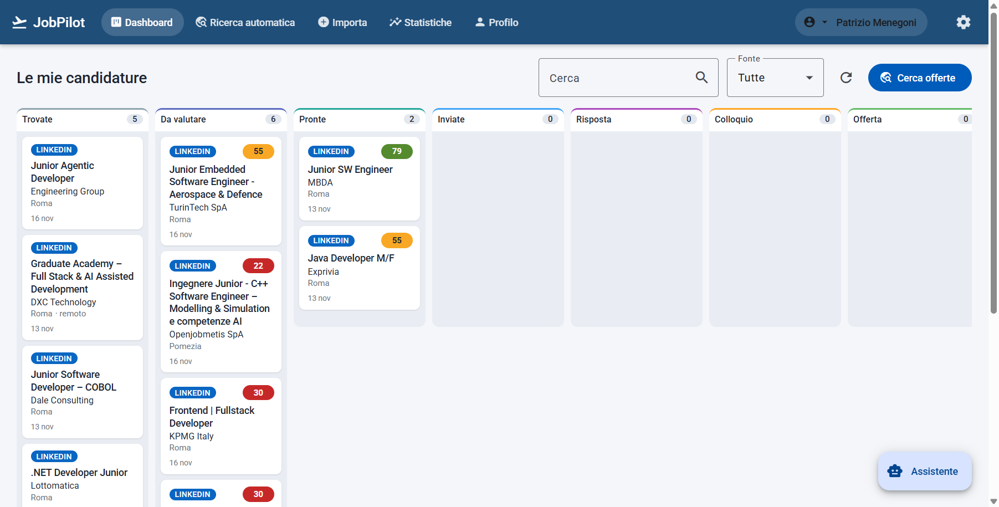
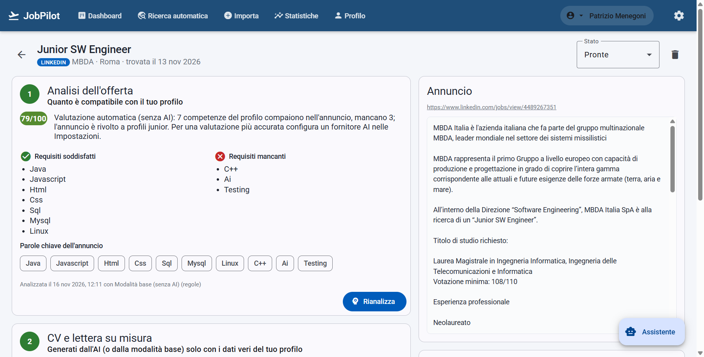
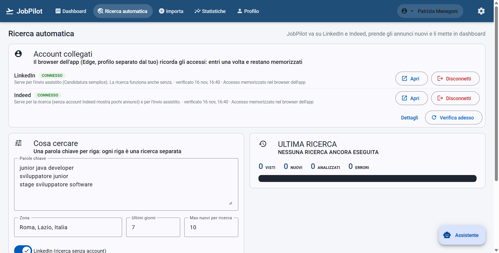
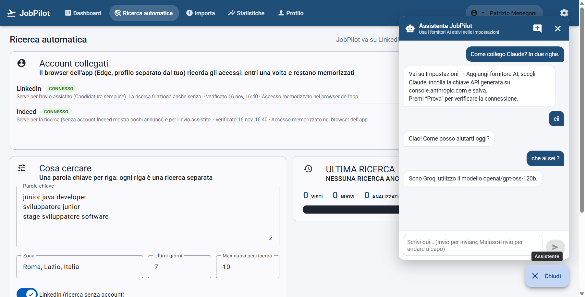

# JobPilot

App desktop personale (Windows) che gestisce la ricerca di lavoro su **LinkedIn** e **Indeed**: cerca da sola le
offerte, le valuta rispetto al profilo con l'intelligenza artificiale, genera CV e lettera di presentazione su misura
in PDF, compila i moduli di candidatura nel browser e tiene traccia di tutto in una dashboard Kanban.
Progetto personale sviluppato come portfolio full stack: **Java 25 + Spring Boot 4**, **Angular 22**, **MySQL 9.7**.



## Cosa fa

- **Ricerca automatica** delle offerte: LinkedIn tramite le pagine pubbliche (senza account), Indeed con una
  finestra di Microsoft Edge pilotata da Playwright. Filtro degli annunci sponsorizzati fuori tema, deduplica,
  ricerca programmata ogni mattina.
- **Analisi AI** di ogni annuncio: punteggio di compatibilità 0-100, requisiti soddisfatti e mancanti, parole
  chiave, segnali di attenzione (seniority, partita IVA, annuncio vago).
- **CV e lettera di presentazione su misura** per ogni offerta, generati solo con i dati veri del profilo
  (regole anti-invenzione nei prompt) e resi in PDF con template HTML.
- **Invio assistito**: l'app apre l'annuncio nel suo browser, clicca "Candidatura semplice" (LinkedIn) o
  "Candidati ora" (Indeed), carica il CV, compila campi e domande con le risposte pronte del profilo e l'AI, e si
  ferma prima di "Invia" per lasciare il controllo finale all'utente.
- **Dashboard Kanban** con stati (Trovata → Da valutare → Pronta → Inviata → Risposta → Colloquio → Offerta),
  promemoria di follow-up e statistiche.
- **Assistente in chat** integrato: conosce il profilo, le candidature e le impostazioni; risponde a domande ed
  esegue azioni (cambiare stato, analizzare, generare documenti, avviare la ricerca, aprire pagine).
- **Più persone**: ogni persona ha profilo, parole chiave e candidature propri.
- **Fornitori AI intercambiabili**: Claude (SDK ufficiale, risposte strutturate), oppure qualsiasi API compatibile
  OpenAI (Groq, Gemini, OpenAI, GitHub Models, Mistral, OpenRouter, Ollama in locale). L'app prova i fornitori
  nell'ordine scelto e, se uno fallisce, passa al successivo; senza AI resta una **modalità base** a regole.
- **Account collegati**: stato "connesso / non connesso" a LinkedIn e Indeed letto dai cookie del browser
  dell'app, con accesso e disconnessione dall'interfaccia.

| Scheda candidatura | Ricerca e account collegati | Assistente |
|---|---|---|
|  |  |  |

## Architettura

```
┌──────────────────────────┐      REST/JSON      ┌───────────────────────────────────┐
│  Angular 22 (frontend/)  │ ◄─────────────────► │  Spring Boot 4.1 (backend/)       │
│  standalone, signals,    │                     │  ├─ search/   LinkedIn + Indeed   │
│  Angular Material        │                     │  ├─ ai/       router + provider   │
│  Kanban drag & drop      │                     │  ├─ apply/    invio assistito     │
│  Assistente in chat      │                     │  ├─ documents/ PDF (Thymeleaf)    │
└──────────────────────────┘                     │  ├─ applications/ profile/ chat/  │
            ▲                                    │  └─ desktop/  tray + finestra     │
            │ finestra Edge --app=                └──────┬──────────┬────────────────┘
      JobPilot.exe (jpackage)                         MySQL 9.7   API AI (Claude, Groq, ...)
```

Tutto gira in locale: il backend ascolta solo su `127.0.0.1`, il frontend compilato è servito dal JAR, l'eseguibile
include il runtime Java (`jpackage`). Le chiavi AI restano sul PC dell'utente in un file leggibile solo da lui.

## Stack

| Componente | Tecnologia |
|---|---|
| Backend | Java 25, Spring Boot 4.1, Spring Data JPA (Hibernate 7), Flyway, Thymeleaf + OpenHTMLtoPDF, jsoup |
| Automazione browser | Playwright Java (Microsoft Edge, profilo dedicato) |
| AI | Anthropic Java SDK (structured output, prompt caching) · client generico `chat/completions` |
| Frontend | Angular 22 (standalone, zoneless, signals), Angular Material, CDK drag & drop |
| Database | MySQL 9.7 LTS |
| Desktop | `jpackage` → `JobPilot.exe` con icona nell'area di notifica |
| Test | JUnit 5, Mockito; `ng build` in produzione |

Scelte tecniche degne di nota: chiamate AI fuori dalle transazioni (`TransactionTemplate`), fallback ordinato tra
fornitori con stato persistito, filtro anti-CSRF e controllo dell'header `Host`, protezione SSRF sugli URL
importati, lucchetto condiviso sul profilo del browser tra ricerca, login e invio assistito.

## Struttura

```
backend/     Spring Boot (API REST, AI, PDF, Playwright)   → .\mvnw.cmd spring-boot:run
frontend/    Angular                                      → npm start
bookmarklet/ "Salva in JobPilot" dal browser normale
scripts/     build dell'eseguibile, installazione MySQL 9.7, ambiente di sviluppo
docs/        piano di progetto, foglio di lavoro, screenshot
output/      PDF generati (non versionato)
```

## Avvio in sviluppo

1. **Requisiti**: JDK 25, Node 26, MySQL 9.7 (lo script `scripts/setup-mysql97.ps1` installa un'istanza
   dedicata come servizio `MySQL97` sulla porta 3307, database e utente `jobpilot`).
2. **Backend**: `cd backend` e `.\mvnw.cmd spring-boot:run` → API su http://127.0.0.1:8080/api
   (credenziali del database in `application.yml`, sovrascrivibili con le variabili `JOBPILOT_DB_*`).
3. **Frontend**: `cd frontend`, `npm install`, `npm start` → http://localhost:4200
4. **Fornitore AI**: dalla pagina Impostazioni dell'app (facoltativo: senza AI funziona in modalità base).

## App desktop

```powershell
.\scripts\build-desktop.ps1
```

Compila il frontend dentro il backend, crea il JAR, lo impacchetta con `jpackage` in `dist\JobPilot\JobPilot.exe`
e mette il collegamento sul Desktop. Al doppio click l'app parte, mette l'icona nell'area di notifica e si apre in
una finestra di Edge senza barra degli indirizzi.

## Test

```powershell
cd backend; .\mvnw.cmd test        # parser, PDF, modalità base, risposte ai moduli, assistente
cd frontend; npx ng build          # build di produzione
```

## Note

- LinkedIn e Indeed non offrono API di candidatura e vietano i bot: per questo l'invio assistito si ferma
  prima di "Invia" (l'invio automatico esiste ma è disattivato di default e segnalato come rischioso).
- Il profilo iniziale caricato dalla migrazione Flyway contiene segnaposto per telefono ed email.
- Documentazione: [docs/PIANO.md](docs/PIANO.md) (piano e architettura),
  [docs/Foglio-di-lavoro-16-nov-2026.md](docs/Foglio-di-lavoro-16-nov-2026.md) (diario dei lavori).
